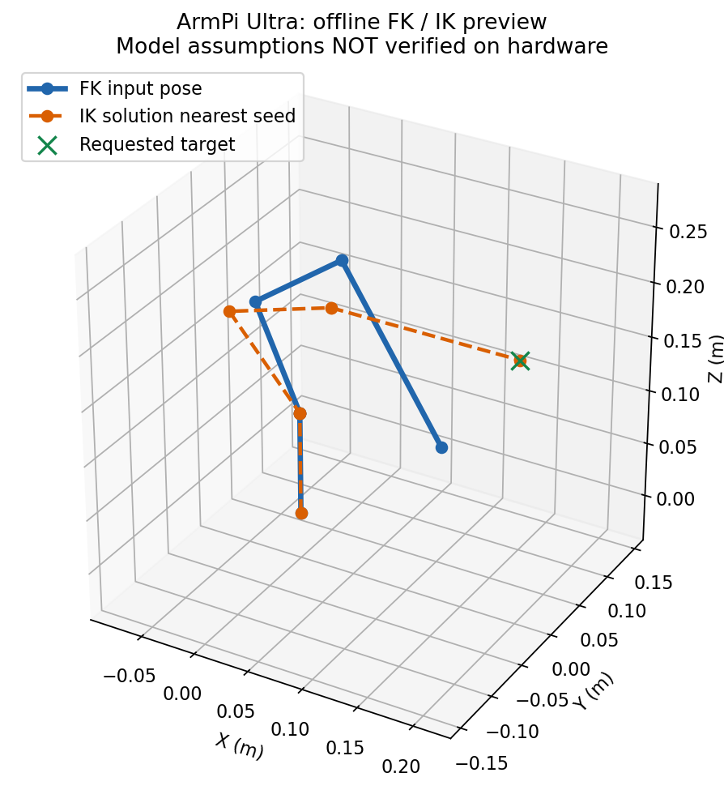

# Python FK／IK 离线实现与验证

日期：2026-10-27。目标设备：x86_64 / Python 3.12.3 / ROS 2 Jazzy。

后续更新：已增加显式启用的独立 ROS 后端、实测反馈读取与部署校验，见 [部署与标定](Python_FK_IK部署与标定.md)。下文保留初版离线实现记录；实机几何/方向仍未完成标定。

已经实现一版可查看、可计算、可测试的 Python 正逆运动学，依据本仓库控制代码的 Modified DH 表、连杆长度和 pulse 映射。**它是待标定的离线几何实现，不是已经验证可替换厂商库的控制后端。** 没有改动现有运动学节点的导入，没有覆盖或改名原 `.so`，也没有开启 `enable_kinematics`。

## 文件与直接运行

- `src/driver/kinematics/kinematics/python_kinematics.py`：NumPy FK、解析几何 IK、角度与 pulse 转换、pitch 范围搜索。
- `scripts/preview_kinematics.py`：离线 CLI，可输出 JSON 和 PNG，不导入 ROS、串口或 pygame，不启动控制节点。
- `tests/test_python_kinematics.py`：23 项几何及输入验证用例，其中一项覆盖 400 组随机姿态。
- `docs/assets/python_fk_ik_roundtrip.json` / `.png`：默认输入的 FK→IK 往返示例。
- `docs/assets/python_fk_ik_target.json` / `.png`：指定目标位置的求解示例。

在本工作区直接执行，不要求加载 ROS 环境：

```bash
cd /home/lyl/ros2_ws
python3 scripts/preview_kinematics.py
```

默认计算五个关节的 pulse `[500,600,825,110,500]`，顺序是 **舵机 ID `[6,5,4,3,2]`**。夹爪开合 ID 1 不属于这五个运动学关节，不能传入第六个数。默认再以 FK 结果作为 IK 目标，检查能否恢复输入姿态。

指定目标并保存报告/示意图：

```bash
python3 scripts/preview_kinematics.py \
  --target 0.20 0 0.20 --pitch 0 \
  --json /tmp/armpi_ik_target.json \
  --plot /tmp/armpi_ik_target.png
```

指定输入脉宽或角度：

```bash
python3 scripts/preview_kinematics.py --pulses 500 600 825 110 500
python3 scripts/preview_kinematics.py --angles-deg 0 -90 0 -90 0
```

普通底座可显式用 `--chassis None`；滑轨用 `--chassis Slide_Rails`，对应底座高度 0.162 m。未显式指定时读取 `CHASSIS_TYPE`，未设置则选普通底座。自定义实际测量长度通过 `ArmGeometry(...)` 传入模型。

计算只依赖 NumPy，`--plot` 额外使用 Matplotlib，当前机器已可用。绘图采用离线后端，只写图片，不弹窗。JSON 中记录 `hardware_verified: false`；pulse 数值只供检查，不会发送。

## 已用数据与尚待核对的约定

依据用户提供的 `3.机械臂高级控制.pdf` 第 16–18 页 DH 内容、第 24–25 页几何 IK 思路，以及 `transform.py` 当前参数：

| 参数 | 当前取值 |
|---|---:|
| 普通底座高度 | 0.094605 m |
| 滑轨底座高度 | 0.162 m |
| 上臂 | 0.10048 m |
| 前臂 | 0.100 m |
| 腕部长度 | 0.055 m |
| 夹持器长度 | 0.115 m |
| 合并工具长度 | 0.170 m |

关节名义范围按教程为 `[-120,120]`、`[-180,0]`、`[-120,120]`、`[-200,20]`、`[-120,120]` 度。没有使用原 `transform.py` 的额外 0.2° 数值放宽；这些范围也不代表没有碰撞。

明确采用以下建模约定：

1. 数学基座 +Z 向上，q1=0 的径向为 +X；基座高度沿 +Z 平移。
2. 逐关节变换为 `Rx(alpha) Tx(a) Rz(theta) Tz(d)`，使用源码 Modified DH 表，没有使用教程中有疑点的最终简化旋转矩阵。
3. 合并工具长度沿第五坐标系的 **+Z** 方向延伸。源码明确了长度相加，但末端坐标方向仍需厂商结果或实物交叉核对。
4. 五个输入角是 DH 关节角，**不是全部以舵机中位为零**；500 pulse 对应关节角 `[0,-90,0,-90,0]` 度。
5. IK 的 `pitch_deg` 是工具轴在 q1 径向平面内相对正径向的几何角，0° 水平向外，+90° 向上，−90° 向下。它不是通用 ZYX 欧拉角分解得到的 pitch，也尚未证明与原 `.so` 的服务 pitch/返回 rpy 语义完全相同。
6. IK 指定 XYZ、几何 pitch 及 q5 角度。q5 只绕工具轴改变朝向，不改变工具端点位置。五自由度不能任意实现独立的六维末端位姿。

现有 URDF 的部分尺寸、关节零位和定义与控制 DH 数据不同，因此没有混用 URDF 参数填补缺项。这里的坐标原点和工具坐标系不能未经核验直接当作视觉标定使用的坐标系。

## 求解方法

设 `S=q2+q3+q4`，`L=腕部长度+夹持器长度`，`h=底座高度`。FK 用矩阵连乘，位置可独立展开为：

```text
r = l1*cos(q2) + l2*cos(q2+q3) - L*sin(S)
x = r*cos(q1)
y = r*sin(q1)
z = h - l1*sin(q2) - l2*sin(q2+q3) - L*cos(S)
geometric_pitch = wrap(-S - pi/2)
```

FK 返回末端位置、3×3 旋转矩阵、4×4 齐次矩阵、四元数 `(x,y,z,w)`、画图用关节位置和几何 pitch。

IK 对每个允许的底座朝向计算带符号的径向位置，扣除工具投影得到腕点，再以余弦定理解两种肘部方向，恢复肩关节与腕关节角。只枚举范围内的等价角，不把非法解裁剪成合法角。候选解会再通过 FK 检查：位置误差不超过 `1e-8 m`、pitch 误差不超过 `1e-7°`。这里的误差阈值是数值一致性检查，不是物理精度。

- 同时考虑朝向目标的正径向分支和转过 180° 的负径向分支，再按关节范围筛选。负径向分支的 pitch 仍相对于该候选 q1 的正径向定义，不是始终相对于目标的正距离方向。
- 提供 `seed` 时按受限关节的绝对转角差排序，不跨机械限位按 360° 取捷径。排序靠近 seed 不代表轨迹无碰撞。
- 目标位于底座轴线上时，底座角无法由 XY 唯一确定；使用 seed 的 q1，未提供 seed 时选择范围内最靠近 0 的角作为代表解，标记 `base_axis_singular=true`，不声称枚举了连续无穷多解。
- 有限合法但不可达的目标返回空列表；错误形状、NaN/Inf、超范围参数抛 `ValueError`。
- `ik_pitch_range` 对范围做有上限的角度网格搜索，优先返回靠近偏好角的样本。没有样本解不证明采样之间也没有解；不复制原厂未公开的候选排序规则。

## Python 接口示例

在加载工作区后可导入已构建的模块，或在脚本中将 `src/driver/kinematics` 加入 Python 搜索路径：

```python
from kinematics.python_kinematics import ArmKinematics

arm = ArmKinematics()
q = arm.pulses_to_angles([500, 600, 825, 110, 500])
pose = arm.fk(q)
print(pose.position)           # 米
print(pose.quaternion_xyzw)    # NumPy 数组，顺序 x,y,z,w

solutions = arm.ik([0.20, 0, 0.20], pitch_deg=0,
                   wrist_angle_rad=0, seed=q)
for solution in solutions:
    print(solution.angles_rad)
    print(arm.angles_to_pulses(solution.angles_rad))  # 仅计算，不下发
```

这里采用显式的 `ArmKinematics.fk/ik` 和结果对象，**不是原 API 的直接替换**：原 `ForwardKinematics.get_fk` 返回包含 ROS Quaternion 的结构，原 `get_ik` 返回分组的关节解和 rpy。新模块不导入 ROS，也没有伪造 `get_position_ik` 的任意六维求解。现有节点仍导入原 `.so` 名称，所有控制链保持原样。

## 本次示例数值

默认输入对应角度约 `[0,-114,78,3.6,0]°`：

```text
FK XYZ = [0.1311233567, 0, 0.1016408255] m
几何 pitch = -57.6°
IK 回代可恢复输入 pulse，差别仅为浮点舍入误差。
```

目标 `[0.20,0,0.20] m`、几何 pitch `0°`、q5=`0°` 的一组模型解：

```text
关节角(deg) ≈ [0, -130.767654, 113.732953, -72.965299, 0]
浮点 pulse ≈ [500, 669.865224, 973.887304, 429.022080, 500]
回代位置误差 ≈ 6.2e-17 m（仅数值模型内误差）
```

该姿态的肘关节已靠近名义上限，不能把“有数学解”当成可以直接执行的结论。这些数值不是厂商库导出值，也不是测量数据。



蓝线为输入姿态，橙色虚线为靠近 seed 的 IK 姿态，绿色标记为请求目标。图是理想连杆示意，不包含外壳、桌面或碰撞体。

## 验证、限制与下一步

已执行：

```bash
python3 -m pytest -q tests/test_python_kinematics.py
source scripts/setup_pc.bash
python3 -m pytest -q tests/test_python_kinematics.py tests/test_live_jog_settings.py \
  tests/test_gamepad_monitor.py tests/test_pc_gamepad.py tests/test_joystick_speed.py \
  tests/test_servo_read_timeout.py tests/test_pc_portability.py tests/test_software_paths.py
colcon build --base-paths src/driver/kinematics --packages-select kinematics --symlink-install
```

结果：新测试 **23 passed**，全部相关测试 **205 passed**，`kinematics` 定向构建成功。覆盖参数/映射与现有源码一致、MDH 与独立基础变换组合一致、解析标准姿态、400 组随机 FK→IK→FK 的位置及完整旋转一致、两种肘解、关节边界、底座轴线退化、工具轴旋转、滑轨高度、四元数半周旋转、非法输入、不可达点和搜索工作量限制。生成两套 JSON/PNG，并查看了目标姿态图。测试和演示都没有发送运动命令。

尚未完成：与原厂库输出逐组比对、实物零位/方向/工具中心点标定、碰撞检测、轨迹规划、真实运动验证。**FK 与 IK 互相一致不能证明几何模型与实机一致。** 原有架构检查仍会报告 ARM `.so` 与本机不兼容，这是预期结果；本次没有把该问题隐藏掉。

接入服务前，先取得原树莓派库对若干已知关节输入的 FK 数值，或测量已有已知姿态的末端坐标，与本模型交叉比对，核实工具轴、基座原点和 pitch/rpy 约定。之后再做显式后端适配，并核对原节点舵机状态的 ID 排序、解选择和输出边界；不要直接把新文件改成原模块名并打开笛卡尔控制。

本轮只新增求解器、离线脚本、测试、报告和图，没有修改机械臂控制代码或默认启动配置。不使用该原型时不再导入即可，现有手柄流程不依赖它。
